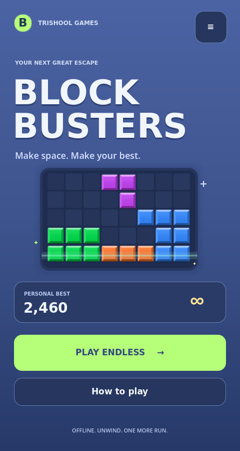
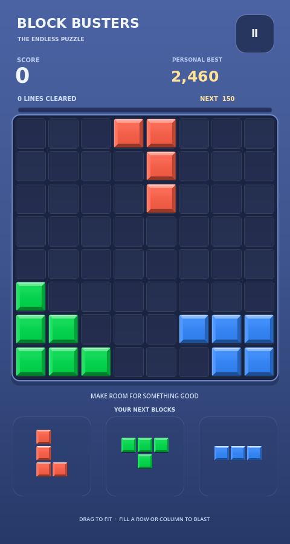
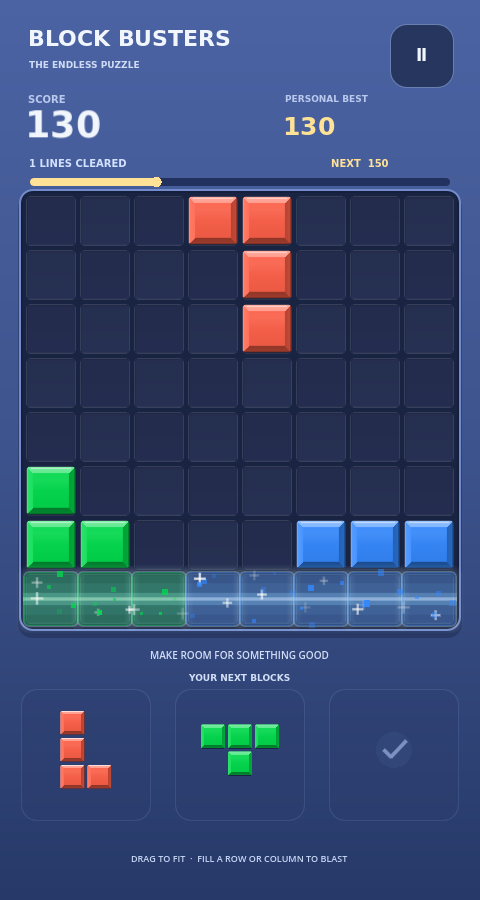

# Block Busters — enhanced grid puzzle v1.2.0

[Download enhanced browser ZIP](https://github.com/games-trishool/Block-Busters/raw/refs/heads/downloads/block-busters-enhanced-v1.2.zip)

The existing8×8 grid-and-piece game now has a redesigned indigo home/gameUI,
tactile beveled cubes, a milestone bar, animated scores, and row/column blasts.
Rendering uses a shared96px tile atlas with bounded effects and retained caches.
This keeps the existing three-piece placement gameplay.

## Run in VS Code

1. Stop any old game server with **Ctrl+C**.
2. Extract the new ZIP into a **new folder**.
3. Open the extracted **Block-Busters** folder in VS Code.
4. With Node.js18+ installed, run:

```sh
npm start
```

Open the terminal's address. No npm install or Godot installation is required
to play the prebuilt browser version. Source and rebuild instructions are included.

## Actual refreshed UI







## Validation

90 gameplay/app/touch checks passed. Rendering cache/effect stress checks
passed51 checks across40 row clears. Actual browser placement, blast,
settings and pause/resume passed without runtime errors.

Rendering targets60FPS. In the same480×900 softwareChromium benchmark,
observed frame cadence improved9.29→22.80FPS idle and8.49→18.68FPS dragging.
These software-renderer measurements do not guarantee physical-device FPS.
See docs/PERFORMANCE.md inside the ZIP for methodology and limits.
Android1.2.0/code3 packages were rebuilt and validated in the cloud workspace;
the Play bundle still needs the developer upload signature and device testing.

ZIP SHA-256: `6460097c7796123a261093a67b5a95a7ab37fd3a3f86f6c2495f5dd59a6bd950`
