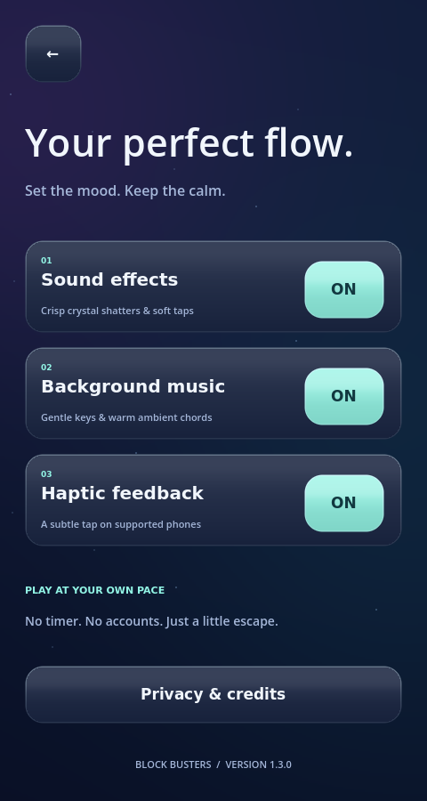

# Block Busters — Crystal Edition v1.3.0

[Download the updated browser ZIP](https://github.com/games-trishool/Block-Busters/raw/refs/heads/downloads/block-busters-crystal-v1.3.zip)

Glossy faceted crystal blocks now reflect light, and completed rows or columns
shatter into rotating glass fragments with crystal sound effects. The home,
game and settings screens have a deeper jewel-colored finish and glass panels.
Original gentle background music loops quietly, with its own saved ON/OFF switch
in Settings. Sound effects and vibration are independent settings.

The existing endless 8×8, three-piece placement rules are preserved.

## Open in VS Code

1. Stop the old game server with **Ctrl+C**.
2. Extract this ZIP into a **new folder**.
3. Open the extracted **Block-Busters** folder in VS Code.
4. With Node.js 18+ installed, run:

```sh
npm start
```

Open the terminal's address. No npm install or Godot installation is required
for the included browser game. To test on a phone, forward port 5173 in VS Code
and use the HTTPS forwarded address. Music begins after your first tap.

## Actual game previews




## Validation

130 Godot gameplay, app, touch, crystal rendering and audio checks pass.
Browser tests verified a real line clear on desktop and phone-size touch
emulation, actual music output after a gesture, independent effects/music
switches, silence with music OFF, and saved OFF behavior after reload.
The extracted ZIP starts with npm start and serves the browser build correctly.

Rendering targets 60 FPS, with a shared crystal texture atlas, cached interface
textures and bounded effects. Physical-phone frame rate remains unmeasured.
Android v1.3.0/code4 debug APK and unsigned AAB were rebuilt and validated in
the cloud workspace. Private signing and device testing are still needed for Play.

ZIP SHA-256: `093a87e856f8c37e30d84424206425953120dd243a2a84febef8d767a0bb0cfe`
